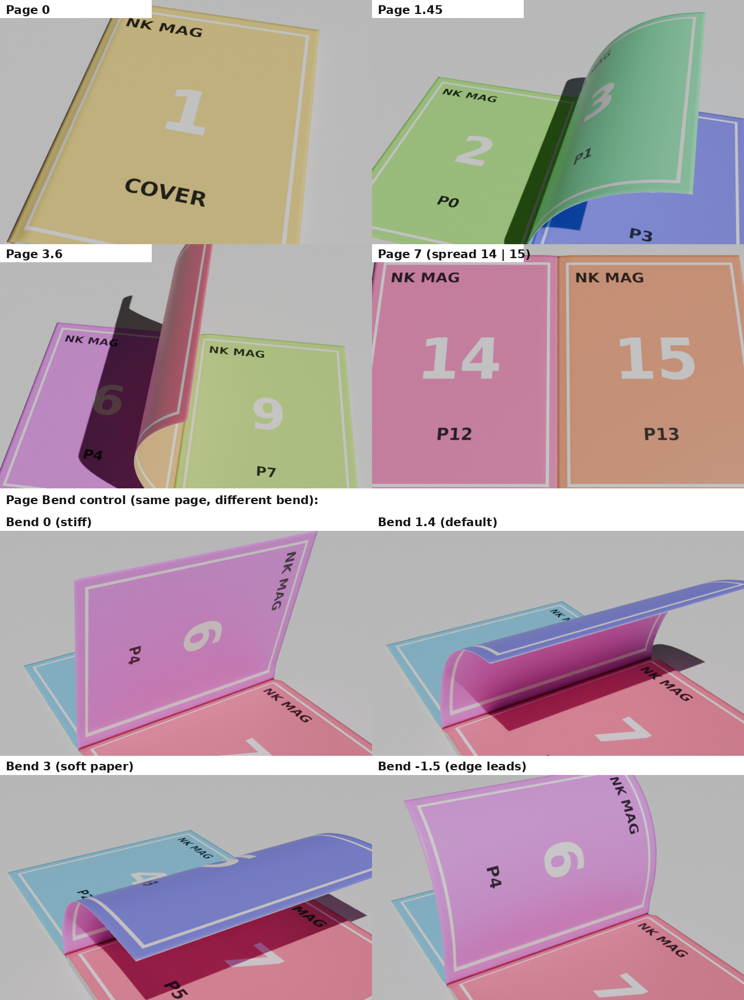

# NK Paper Bend 4.0

Procedural paper, card, page, magazine and ribbon motion for Blender 4.2 – 5.2+.
One Geometry Nodes engine drives every effect; you animate a single **Progress** slider.

## Presets
- **Paper:** Roll, Scroll Reveal, Fold in Half, Card Peel, Sticker Peel
- **Pages:** Page Flip, Page Fan, Magazine
- **Ribbon & Loops:** Ribbon Candy, Ribbon Flow ∞, Twist Ribbon, Floating Paper ∞, Banner Wave ∞

## Features
- Smart controller Empty: put it on any edge or corner and that side moves
- Full sheet size control (A4, Letter, Magazine, Book, Square, 4:5, 9:16, 16:9, Card, Postcard, Custom)
- Optional front/back images, fit sheet to image, cut shape from PNG transparency
- Magazine with real page turn, binding, per-page full-resolution images
- Page controls: Next/Prev page keyframing, Bend, Bend at Edge, Turn Angle, Overlap
- One-click keyframes with easing, seamless loops

## Install
1. Download `dist/nk_paper_bend-4.0.0.zip`.
2. Drag it into Blender, or **Edit › Preferences › Get Extensions › Install from Disk**.
3. Press **N** in the 3D Viewport and open the **NK Bend** tab.

## دامەزراندن (کوردی)
1. فایلی `dist/nk_paper_bend-4.0.0.zip` دابگرە.
2. ڕایبکێشە ناو Blender، یان لە Edit › Preferences › Get Extensions › Install from Disk هەڵیبژێرە.
3. لە ڤیوپۆرت N دابگرە و بچۆ تابی **NK Bend**.

## Author
**Nihad Jihad** · 0750 760 0111 · [WhatsApp](https://wa.me/9647507600111) · nsmarketingkrd@gmail.com

License: GPL-3.0-or-later
