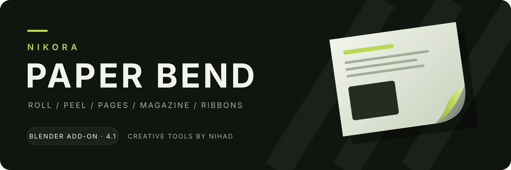
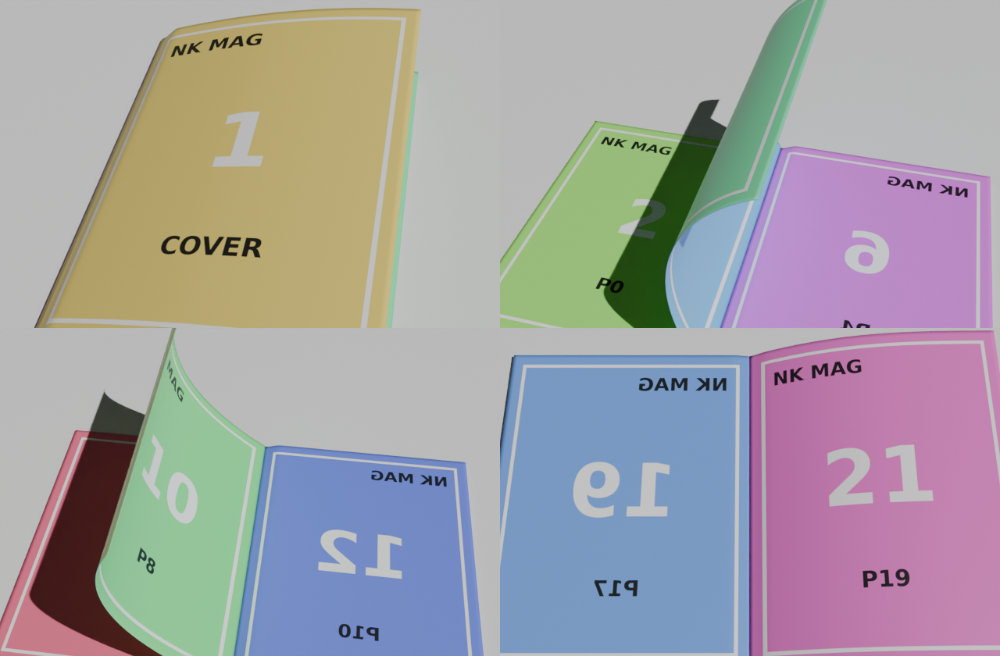
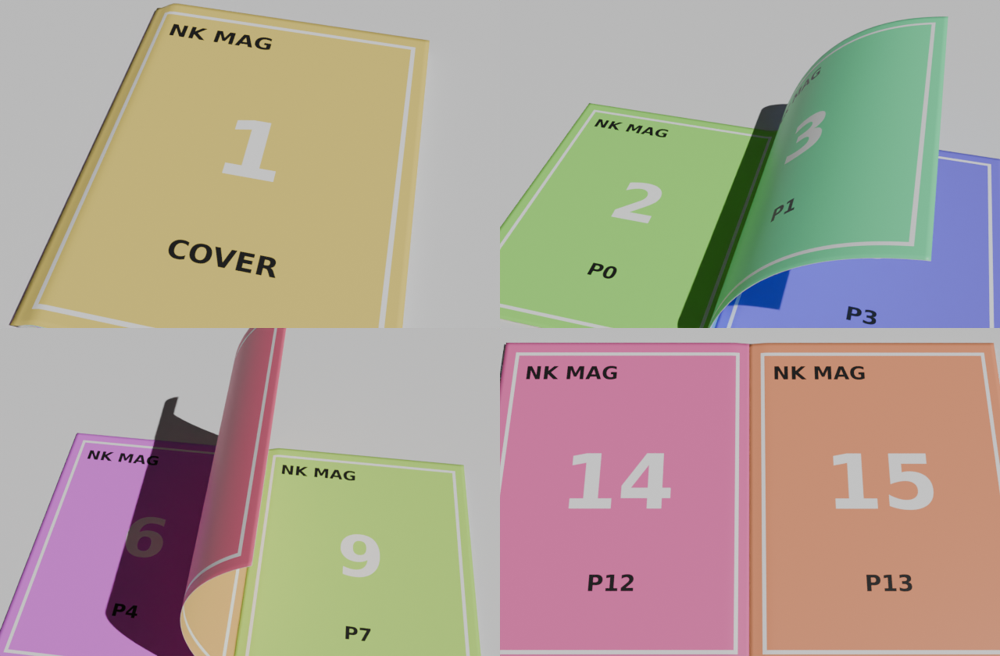
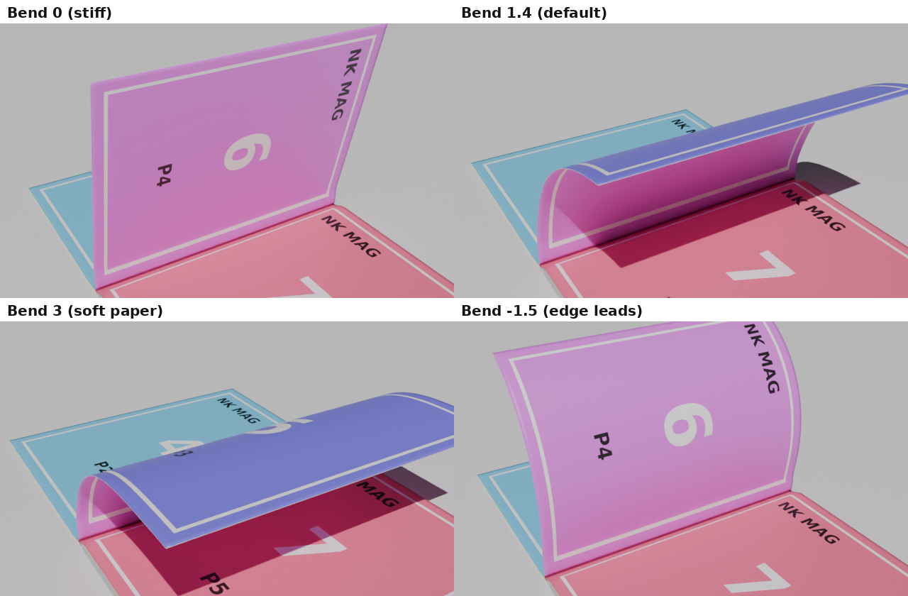

# Nikora Paper Bend 4.1

Part of **NIKORA — نیکۆرا**, creative tools by Nihad. [Shared brand](NIKORA-BRAND.md).

A Blender add-on for paper, cards, pages, magazines and ribbons that bend and animate.
One Geometry Nodes engine drives every effect, and a single **Progress** slider animates it.
Works in Blender 4.2 – 5.2+, Cycles and EEVEE.

## Presets

| Paper | Pages | Ribbon & Loops |
|---|---|---|
| Roll | Page Flip | Ribbon Candy |
| Scroll Reveal | Page Fan | Ribbon Flow ∞ |
| Fold in Half | Magazine | Twist Ribbon |
| Card Peel | | Floating Paper ∞ |
| Sticker Peel | | Banner Wave ∞ |

## Features

- **Smart controller:** put the Empty on any edge or corner and that side moves.
- **Full sheet size:** A4, Letter, Magazine, Book, Square, 4:5, 9:16, 16:9, Card, Postcard or custom, with rounded corners.
- **Optional images:** front and back images, fit the sheet to an image, or cut the shape from PNG transparency.
- **Magazine:** real page turns, binding and gutter, full-resolution image per page.
- **Page control:** Next/Prev page keyframes, Bend, Bend at Edge, Turn Angle, Overlap and spine side.
- **Motion design:** one-click keyframes with easing, seamless loops, flutter and twist.

 

 

## Install

1. Download [`dist/nikora_paper_bend-4.1.0.zip`](dist/nikora_paper_bend-4.1.0.zip).
2. Drag it into Blender, or use **Edit › Preferences › Get Extensions › Install from Disk**.
3. Press **N** in the 3D Viewport and open the **Nikora** tab.

Upgrading from NK Paper Bend 4.0: the extension id stays `nk_paper_bend`, so it replaces the old
version in place and existing scenes keep working.

## دامەزراندن

١. فایلی `dist/nikora_paper_bend-4.1.0.zip` دابگرە.
٢. ڕایبکێشە ناو Blender، یان لە Edit › Preferences › Get Extensions › Install from Disk هەڵیبژێرە.
٣. لە ڤیوپۆرت **N** دابگرە و بچۆ تابی **Nikora**.

پریسێتێک هەڵبژێرە، دواتر تەنها **Progress** لە 0 بۆ 1 ئەنیمەیت بکە. Empty ـەکە بخەرە سەر هەر لایەک یان گۆشەیەک، ئەو لایە دەجوڵێت.

## Contact

**Nihad Jiad Yousef** · 0750 760 0111 · [WhatsApp](https://wa.me/9647507600111) · nihadgihadyousif@gmail.com

License: GPL-3.0-or-later.

